# Secure Multi-AZ AWS VPC with Terraform

A production-style AWS network built entirely as Infrastructure as Code: a VPC with public and private subnets across two availability zones, internet and NAT gateways, explicit routing, least-privilege security groups and a locked-down default security group. Every resource was planned, applied, verified in the AWS console and then destroyed from code.

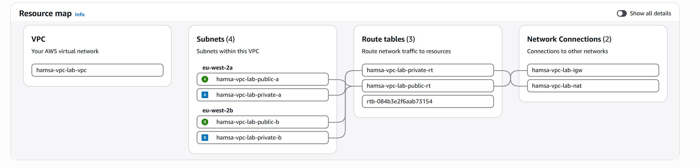

## At a glance

| | |
|---|---|
| **Tooling** | Terraform (AWS provider `~> 6.0`), AWS CLI, VS Code |
| **Region** | `eu-west-2` (London), 2 availability zones |
| **Resources** | 18, all managed by Terraform |
| **Network** | VPC `10.0.0.0/16`, 2 public `/24` subnets, 2 private `/24` subnets |
| **Security focus** | Private tier with no inbound internet route, no auto-assigned public IPs, explicit route table associations, SG ingress scoped to the VPC, default SG stripped of all rules |

## Architecture

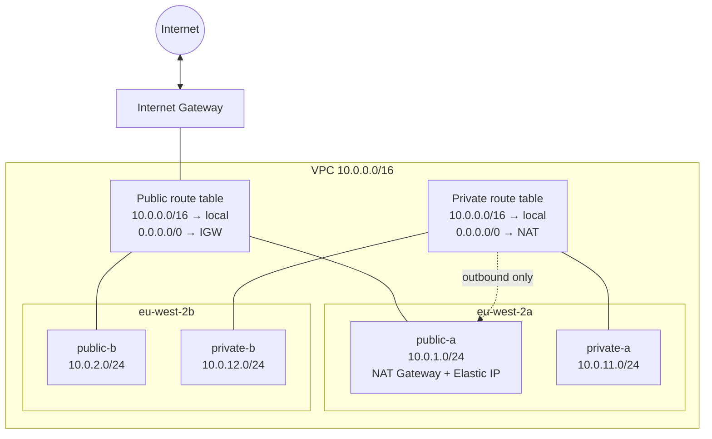

**Traffic flow:** public subnets route to the internet gateway (two-way). Private subnets route to the NAT gateway, so they can reach the internet for updates but nothing on the internet can initiate a connection to them.

## Repository layout

| File | Purpose |
|---|---|
| `providers.tf` | AWS provider and version pin |
| `variables.tf` | All tunable inputs: region, name prefix, CIDR ranges, subnet maps |
| `main.tf` | Every resource: VPC, subnets, gateways, route tables, security groups |
| `outputs.tf` | IDs and IPs exposed for other code or teams to consume |
| `.gitignore` | Keeps state files, provider binaries and tfvars out of version control |

## Build walkthrough

Each stage followed the same loop: **write → `terraform plan` → review → `terraform apply` → verify in the console.**

### 1. VPC

Created the VPC with DNS support and DNS hostnames enabled (many AWS services depend on these). The CIDR and name come from variables, so the same code can be reused for another environment by changing inputs only.

The plan shows values I set (CIDR, DNS, tags) alongside `(known after apply)` attributes that AWS assigns at creation, such as the VPC ID. It also shows AWS creating a default route table, network ACL and security group automatically, which is handled in step 7.

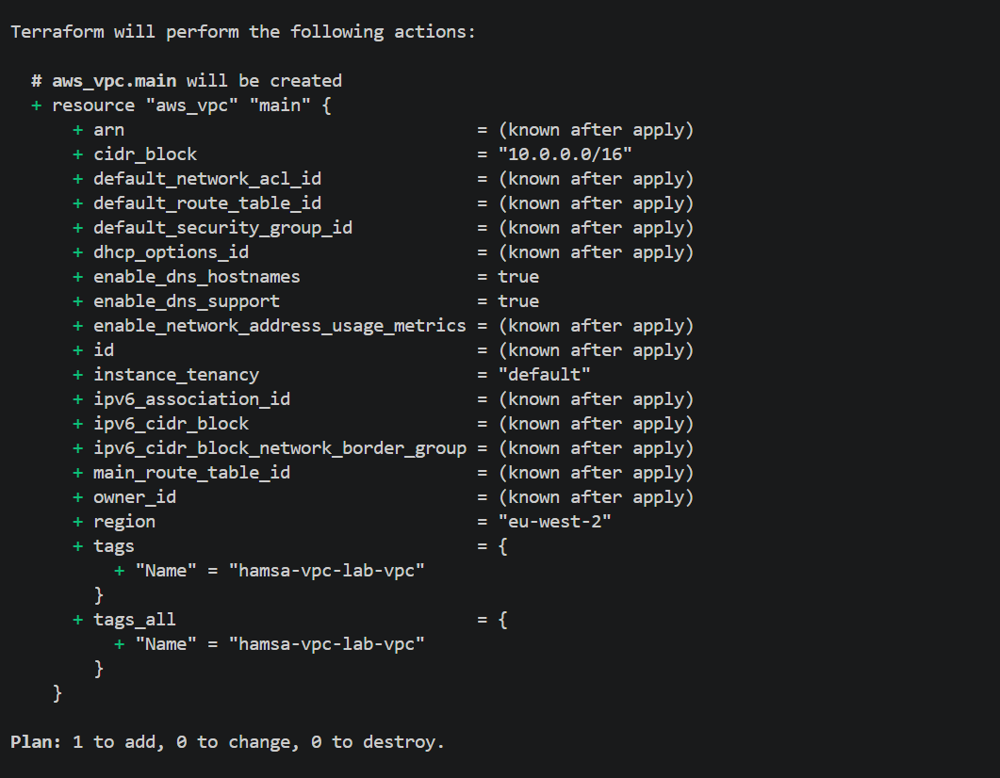
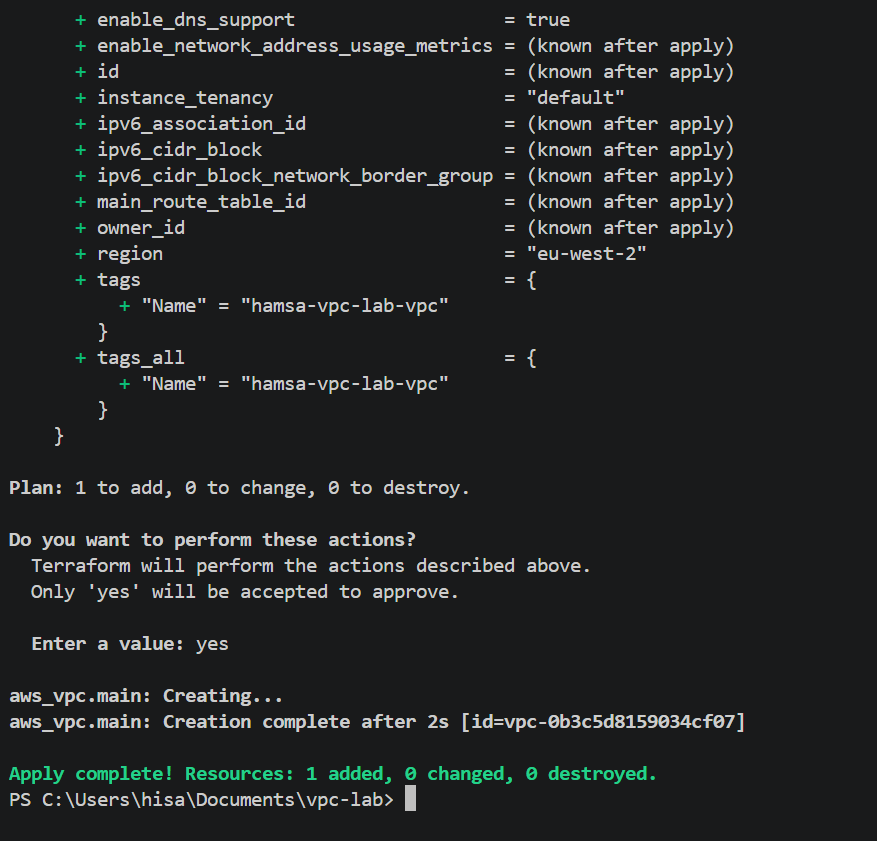
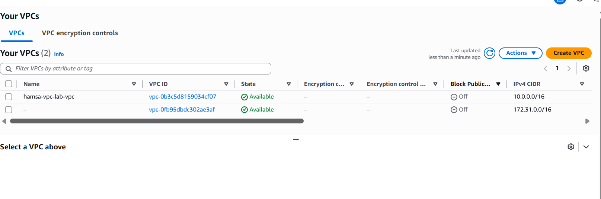

### 2. Subnets with `for_each`

Four subnets from two resource blocks. Each block loops over a map variable (`AZ letter = CIDR`), so `each.key` builds the AZ name and `each.value` supplies the CIDR. Adding a third AZ means adding one line to `variables.tf`, with no change to `main.tf`.

`map_public_ip_on_launch = false` on the public subnets means nothing gets a public IP by accident; public addressing has to be a deliberate choice.

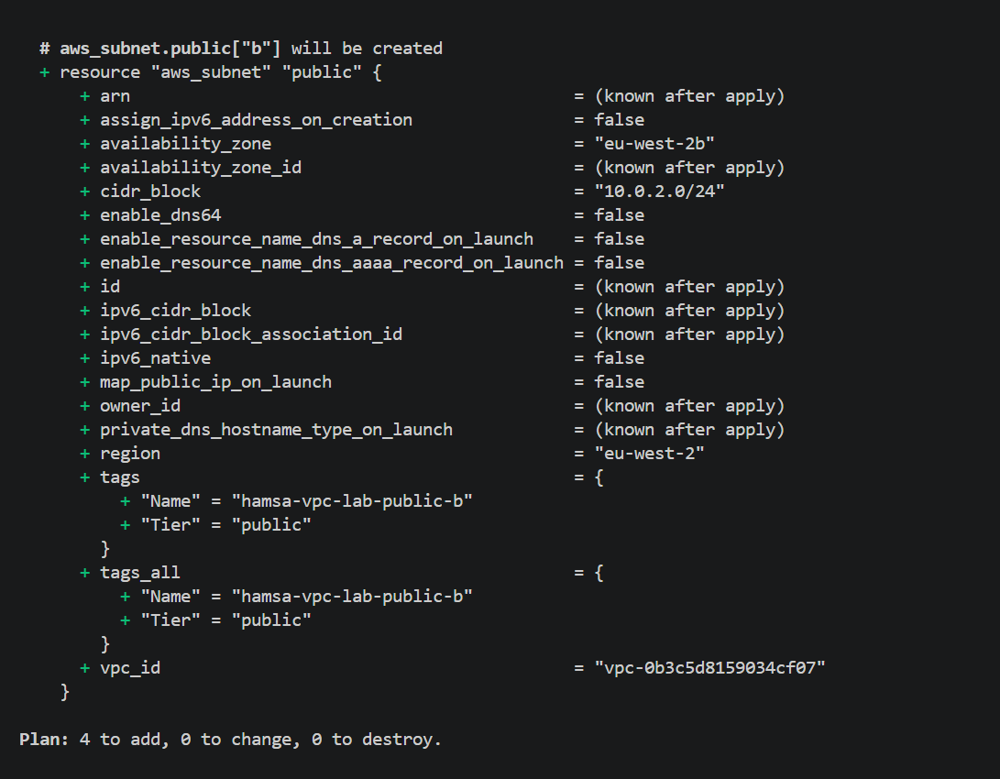
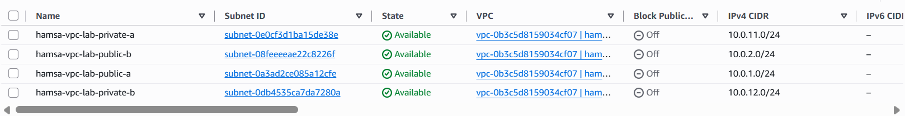

### 3. Internet gateway

Attached to the VPC. On its own it routes nothing; a route table has to point at it.

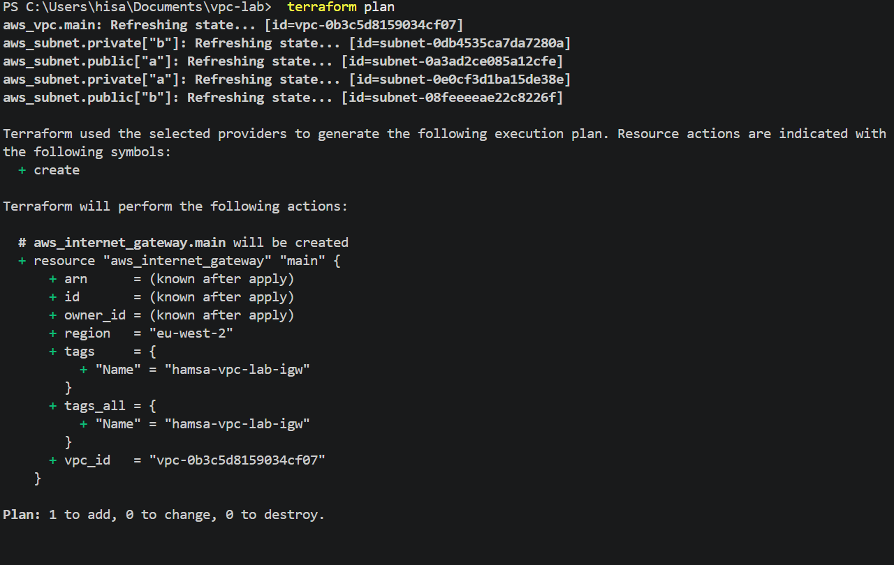
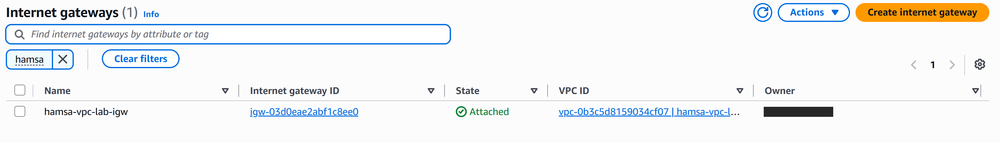

### 4. Public route table

A route of `0.0.0.0/0 → internet gateway`, plus a `for_each` association over `aws_subnet.public`. Looping over a **resource** means `each.value` is the whole subnet object, so `each.value.id` selects its ID.

This is the step that actually makes a subnet public. The associations screenshot also shows the private subnets falling back to the VPC's main route table at this point, which step 6 fixes.

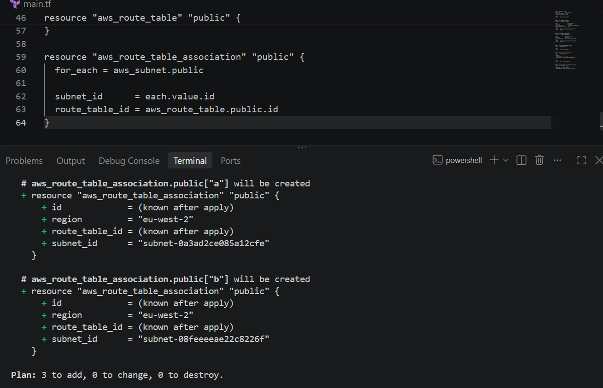
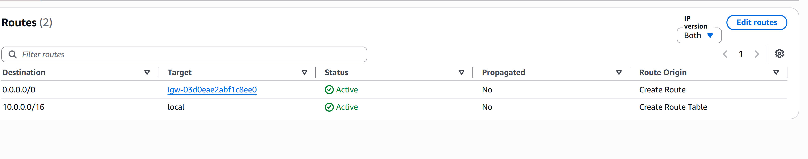
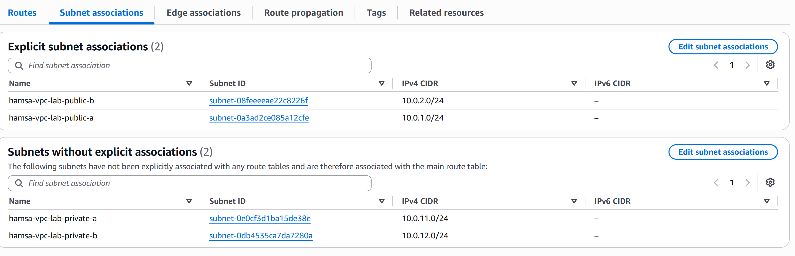

### 5. NAT gateway and Elastic IP

Placed in `public-a` (`aws_subnet.public["a"].id`) with a static Elastic IP. `depends_on` is used because the NAT gateway needs the internet gateway to function but does not reference it directly, so Terraform cannot infer the dependency.

**Design trade-off:** a single NAT gateway keeps lab costs low. In production I would deploy one per AZ so that losing `eu-west-2a` does not cut off outbound access for private subnets in `eu-west-2b`.

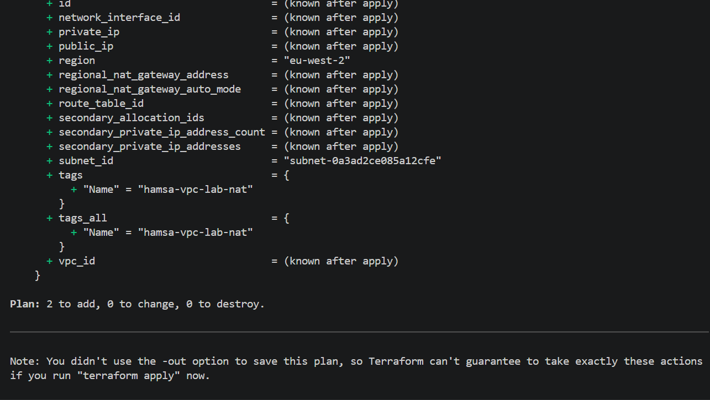
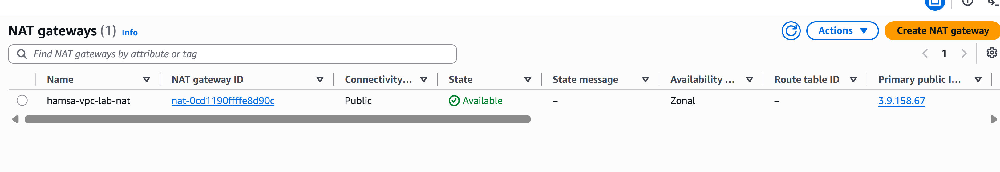

### 6. Private route table

Identical pattern to the public table, except the default route targets `nat_gateway_id`. That single line is the whole difference between a public and a private subnet. Both private subnets are now explicitly associated, so no subnet relies on the main route table.

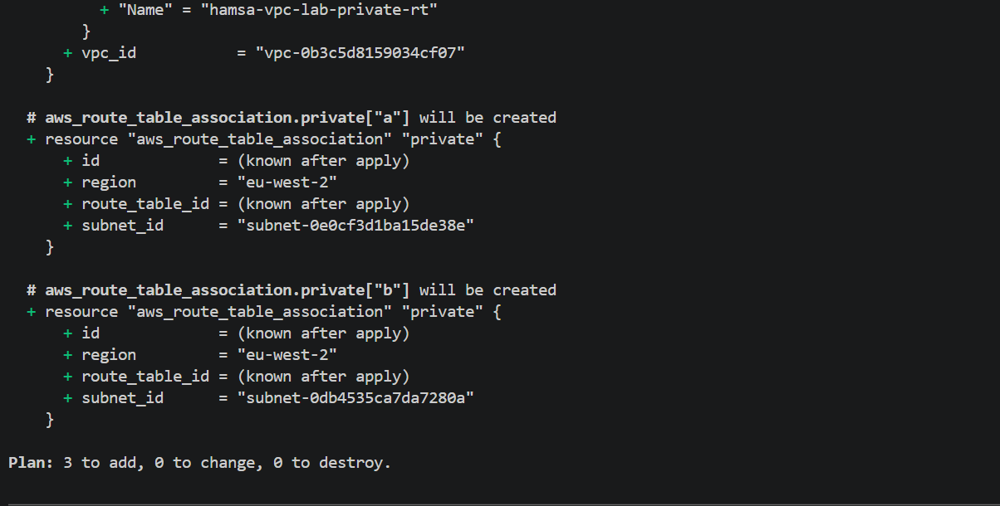
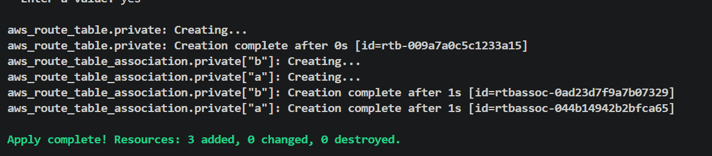
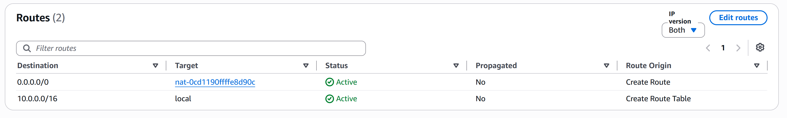

### 7. Security groups

- **App security group:** ingress allows HTTPS (443/TCP) **only from inside the VPC** (`10.0.0.0/16`), never `0.0.0.0/0`. Each rule is its own resource (`aws_vpc_security_group_ingress_rule` / `egress_rule`), the current AWS provider recommendation, which makes individual rules easier to review.
- **Default security group locked down:** `aws_default_security_group` with no rules adopts the AWS-created default group and removes all its rules. Anything launched without an explicit security group gets no network access at all.

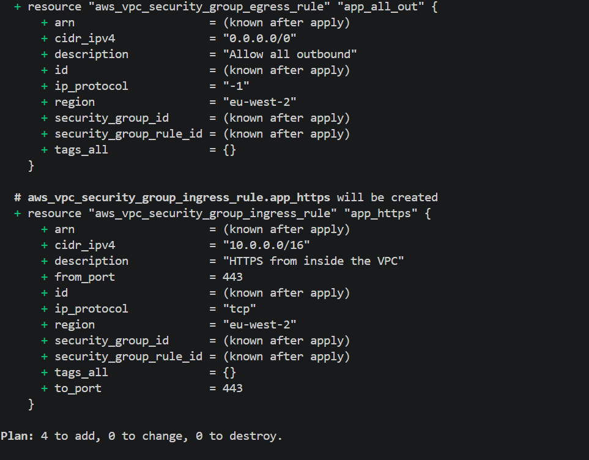
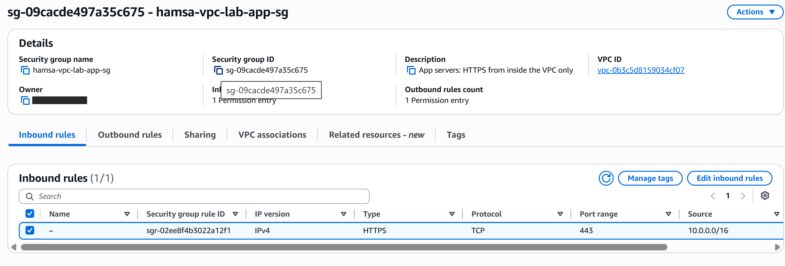
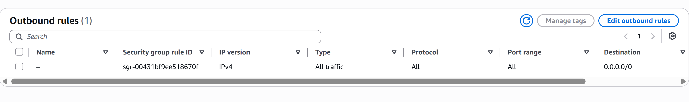
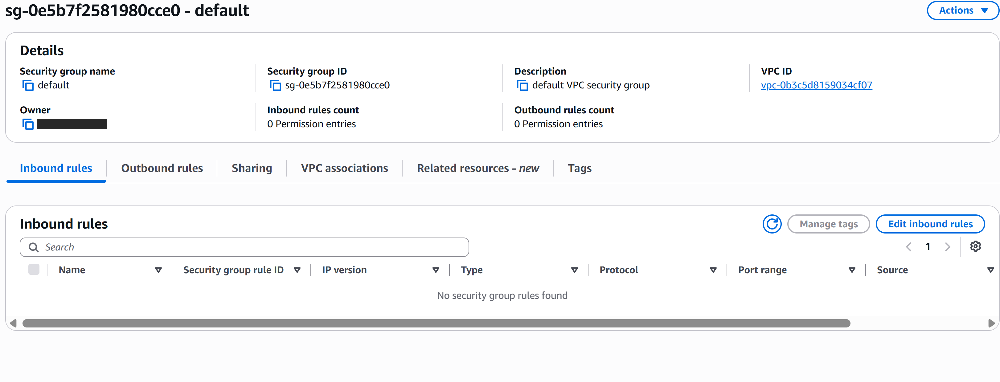
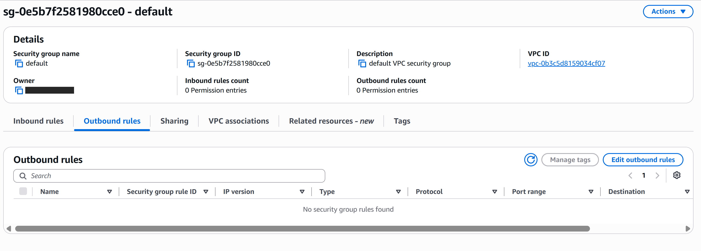

### 8. Outputs

VPC ID, subnet ID lists (built with `for` expressions), the NAT public IP and the app security group ID. These are what a downstream team or module would consume to launch workloads into the network.

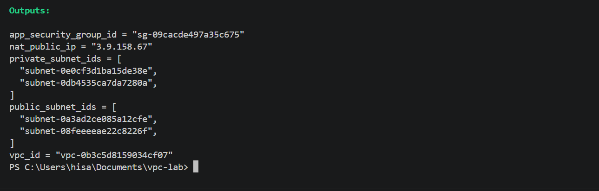

### 9. Teardown

`terraform destroy` removed all 18 resources in reverse dependency order, with no manual cleanup. The NAT gateway took about 70 seconds and Terraform waited for it before removing the internet gateway and Elastic IP it depended on.

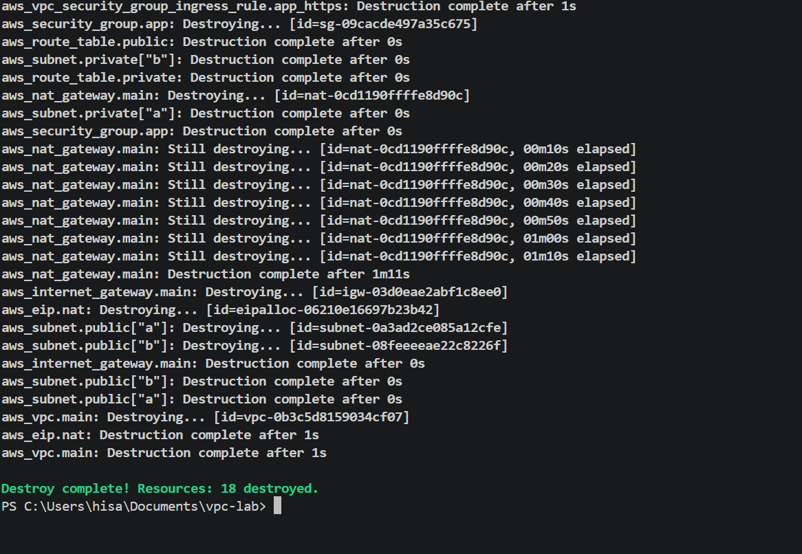

## Security decisions

| Control | Implementation | Risk it addresses |
|---|---|---|
| Private tier | Private subnets route only via NAT | No inbound path from the internet to sensitive workloads |
| No accidental public IPs | `map_public_ip_on_launch = false` | Instances exposed by default |
| Explicit route associations | Every subnet linked to a named table | A change to the main route table silently exposing subnets |
| Scoped ingress | HTTPS from `10.0.0.0/16` only | Services reachable from `0.0.0.0/0` |
| Default SG locked | All rules removed | Resources landing in a permissive default group |
| Secrets out of code | Credentials via `aws configure`, state and tfvars git-ignored | Leaked keys or state in a public repo |
| Version pinning | `~> 6.0` provider constraint plus lock file | Unreviewed provider changes |
| Tagging | `Name` and `Tier` on all resources | Untracked or orphaned resources in audits |

## Troubleshooting log

Real issues hit during the build and what fixed them:

| Error | Cause | Fix |
|---|---|---|
| `Inconsistent dependency lock file` | `terraform init` ran before `providers.tf` was saved, so no provider was recorded | Save all files, re-run `terraform init` |
| `Reference to undeclared input variable` | `variables.tf` was empty on disk while `main.tf` referenced `var.vpc_cidr` | Populate and save `variables.tf`; Terraform resolves `var.*` across every `.tf` file in the folder |
| `No changes` when changes were expected | Unsaved editor buffer, so Terraform read an empty file | Save before planning (or enable Auto Save) |

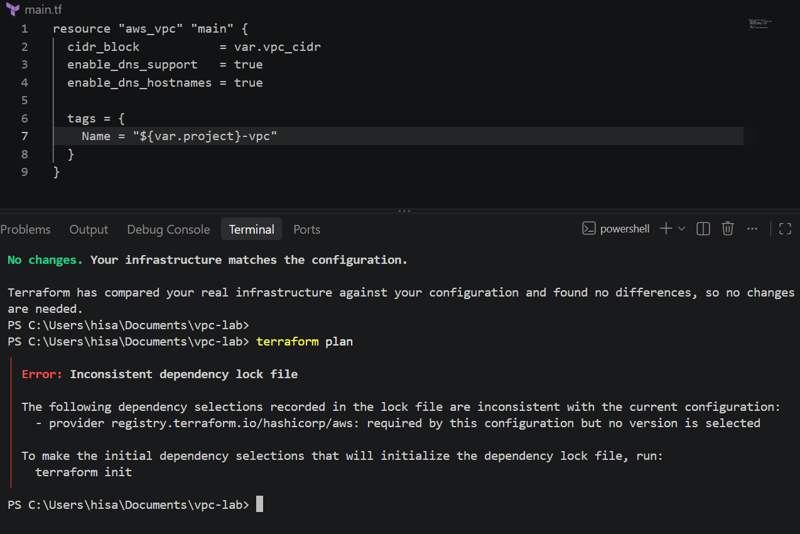
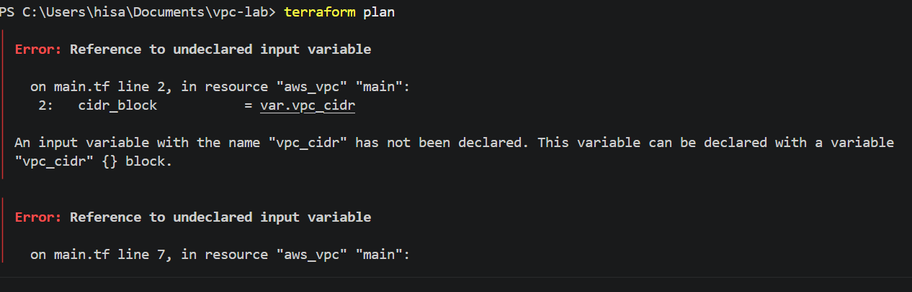

## How to run

Prerequisites: Terraform, AWS CLI v2, and credentials configured with `aws configure`.

```bash
terraform init
terraform plan
terraform apply
terraform output
terraform destroy   # the NAT gateway and Elastic IP are billed hourly
```

To change the design, edit `variables.tf`, for example add `c = "10.0.3.0/24"` to `public_subnets` for a third AZ.

## Next improvements

- **VPC Flow Logs** to CloudWatch Logs or S3, so connection metadata is available for detection and incident investigation
- **Remote state** in an encrypted S3 backend with locking
- **Refactor into a reusable module** called from per-environment configurations
- **One NAT gateway per AZ** for resilience
- **Egress filtering** to restrict the app security group's outbound traffic
- **CI pipeline** (GitHub Actions) running `terraform fmt`, `validate`, a Checkov scan and `plan` on every pull request
- **Short-lived credentials** via IAM roles / OIDC instead of long-lived access keys
